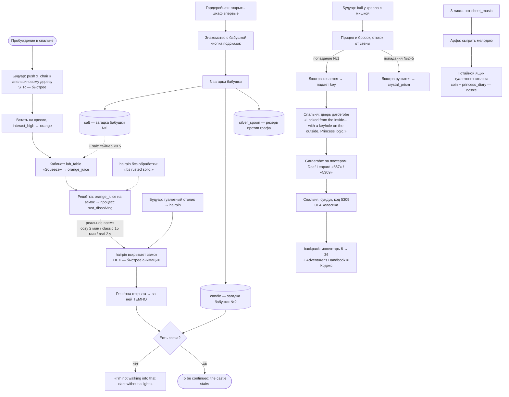

# PUZZLES — граф загадок (v2.1, 21.10.2026)

Источник правды для загадок. Реализация — заход 2 (L-1…L-5), все данные — в `game/data/*.json` (предметы, рецепты рук, реакции, загадки бабушки, подсказки), ни одной строки в коде. Строки игры — только английский (ключи `SAY_*` / `HINT_*` / `RIDDLE_*` в `data/i18n/strings.csv`).

**Правила графа**
- Обязательный путь короткий; в каждой комнате анфилады есть хотя бы один нужный предмет.
- Побочные ветки вознаграждают (вместимость, Кодекс, монеты, предметы на потом), но не блокируют.
- Статы дают доп. пути и бонусы и **никогда** не блокируют прохождение (GAME_DESIGN §12).
- Инструменты — против предметов, не против людей (CLAUDE.md: оружия нет). Кол против графа — нет.
- Реакции абстрагированы (CLAUDE.md §6): без пропорций, температур и методик.

## 1. Покои принцессы (Акт 1, старт)

**v2.1 — адреса по карте v3** (логика цепочки не меняется; CASTLE.md §1). Кабинет — хаб: из спальни правый проход, дальше направо будуар и музыкальная, задняя дверь кабинета — гардеробная.

| Предмет / место | Комната | Как попасть из спальни |
|---|---|---|
| кровать (look under → монета), тумбы (спички), портрет графа, сундук 5309, камин, ширма, шкура тигра | Спальня (без окон) | — |
| постеры, надписи 867 / 5309, туалетная бумага, пульт | Garderobe (от первого лица) | задняя дверь спальни (нужен ключ) |
| верстак-лаборатория (сок, соль; горелка на столе), книжный шкаф, секретер с письмом, телескоп, глобус | Кабинет | правый проход спальни |
| hairpin (туалетный столик), x_chair + мишка, мяч, люстра (ключ, призма), апельсиновое дерево, канарейка | Будуар | спальня → кабинет → правый проход кабинета |
| арфа, пюпитр + виолончель, граммофон, пластинки, 3 листа нот | Музыкальная | … → будуар → правый проход будуара |
| шкаф (скелет, бабушка, загадки), 3 головы (монета у дракона), манекен, зеркало, вешалка, корзина (чулки), решётка с ржавым замком → лестница | Гардеробная | спальня → кабинет → дверь в задней стене кабинета |

**Цель:** выйти через решётку гардеробной на винтовую лестницу.

## 2. Обязательный путь — шаги

| # | Предмет | Где | Действие | Результат | Подсказки бабушки (1 → 2 → 3) | Мысль героя при INT | science_note |
|---|---|---|---|---|---|---|---|
| 1 | hairpin | Будуар, туалетный столик | Inspect → взять | шпилька в инвентаре; на ржавом замке: «It's rusted solid.» | — (берётся сама) | — | — |
| 2 | x_chair | Будуар, туалетный уголок | Push к апельсиновому дереву (STR ускоряет) | кресло под деревом | «Some oranges are only for tall princesses. Or clever ones.» → «That chair isn't nailed down, dear.» → «Push the chair under the tree and climb up.» | «The oranges are too high... I need something to stand on.» | — |
| 3 | orange | Будуар, апельсиновое дерево | Встать на кресло (interact_high) → Pick an orange | orange | (вместе с шагом 2) | — | — |
| 4 | orange → orange_juice | Кабинет, алхимический верстак (lab_table) | Use → крупный план → «Squeeze orange» | orange_juice (+ salt рядом — таймер следующего шага ×0.5) | см. «замок» ниже | «Rust... iron... maybe something sour?» | «Oranges are full of citric acid — that's what makes them sour.» |
| 5 | orange_juice | Гардеробная, замок решётки | Use → процесс `rust_dissolving` на реальном времени (cozy 2 мин / classic 15 мин / real 2 ч), видно в панели процессов; можно ходить по покоям | замок «размякает» | **замок:** «Rust is just iron that gave up. Cheer it up with something sour.» → «Sour... like that orange tree nobody waters but me.» → «Squeeze the orange on the lock, dear. And then wait. Patience is a princess virtue.» | «Rust... iron... maybe something sour?» | «Citric acid slowly dissolves rust — that's how many store-bought rust removers work. Salt is a mild abrasive that helps scrub it off.» (`verified: false`) |
| 6 | hairpin | Гардеробная, замок | Use (DEX ускоряет анимацию) | решётка открыта; первая запись Кодекса — после реакции с ржавчиной (если рюкзак уже найден; иначе — при находке) | «A lock is just a puzzle that rusted.» → «Your hairpin, dear. It's not just for hair.» → «Use the hairpin on the lock. Now.» | «Now the hairpin might actually work.» | — |
| 7 | candle | Гардеробная, за решёткой | Нужна свеча: без неё «I'm not walking into that dark without a light.» | с candle → «To be continued: the castle stairs» | «It's dark. Even ghosts don't like the dark.» → «I asked you about something that weeps wax tears, remember?» → «Solve my second riddle and take the candle, dear.» | «Too dark. I need a light.» | — |

## 3. Знакомство с бабушкой

При **первом** открытии шкафа в гардеробной (скелет на дне шкафа к ней не относится — просто «skeleton in the closet»).

| Кто | Реплика (en) |
|---|---|
| Ghost | Hey! Peeking into a lady's wardrobe? Shameless! |
| Hero | Sorry! I come in peace. I was... kidnapped by a vampire. |
| Ghost | Ugh, that old fool. Mixed up the windows again, didn't he? He's blind as a bat. Literally. |
| Ghost | I could help you... but I'm a ghost. Ghosts are lazy. Tell you what — solve my riddles, and I'll give you something for each one. |

С этого момента доступна кнопка подсказок (корона в HUD). До знакомства — только мысли героя (INT).

## 4. Загадки бабушки

Выбор из 3 ответов. Неверный — бабушка ворчит, можно снова (без штрафа).

| # | Загадка (en) | Варианты | Ответ → награда | Ворчание при ошибке (en) |
|---|---|---|---|---|
| 1 | «Without me, soup is sad — and yet I'm in every tear you cry.» | salt / sugar / water | **salt** → `salt` | «Sugar in tears? What kind of sad sweet life did YOU have?» |
| 2 | «I eat my own body to give you light, and weep wax tears all night.» | candle / moth / fireplace | **candle** → `candle` | «A fireplace doesn't weep, dear. It just smokes. Like the Count.» |
| 3 | «Vampires hate my shine. I stirred a princess's tea for ninety years.» | silver_spoon / garlic / mirror | **silver_spoon** → `silver_spoon` (резерв против графа) | «Garlic doesn't stir tea. I tried.» |

## 5. Побочная ветка «Рюкзак» (почти обязательная)

Без рюкзака не хватит карманов (пижама 2×3 = 6 слотов).

| # | Предмет | Где | Действие | Результат | Подсказки (1 → 2 → 3) | science_note |
|---|---|---|---|---|---|---|
| 1 | ball | Будуар, у кресла с мишкой | Взять в руку → прицел → бросок с отскоком (L-4) | попадание №1: люстра качается, падает `key` | **люстра/ключ:** «That chandelier has been hiding something for years.» → «Things fall when you hit them, dear. Physics.» → «Kick the ball. Off the wall. At the chandelier.» | «The angle a ball hits a wall at equals the angle it bounces off.» |
| 2 | key | Будуар, под люстрой | Pick up | key | — | — |
| 3 | key | Спальня, дверь garderobe | Open (ключ в руке) | «Locked from the inside... with a keyhole on the outside. Princess logic.» → дверь открыта | — | — |
| 4 | — | Garderobe, постер Deaf Leopard | Move poster | на стене столбиком «867» / «5309» | **сундук:** «Someone in the garderobe had a lot of time to write things on walls.» → «Behind the posters, dear.» → «The last four digits. Honestly.» | — |
| 5 | — | Спальня, сундук | UI 4 колёсика, код 5309 | `backpack` (инвентарь 6 → 36) + Adventurer's Handbook (Кодекс): «My backpack! What's it doing in a princess's chest?» | (как выше) | — |

## 6. Бонусы

| Бонус | Как | Награда | Реплики / факт |
|---|---|---|---|
| Люстра рушится | попадания №2–5 мячом | `crystal_prism` | после 3-го попадания, если бабушка знакома: «Do you want the Count up here?!»; science_note: «A glass prism bends each colour of light by a different amount — that's how it splits white light into a rainbow.» |
| Арфа (музыкальная) | 3 листа `sheet_music` → сыграть мелодию на арфе | потайной ящик туалетного столика: coin + `princess_diary` (реализовать позже) | — |
| Монеты | под кроватью; в пасти драконьей головы (гардеробная, над шкафом; «Reach in», поза interact_high: «Sorry, big guy. Finders keepers.»); внутри глобуса | coin ×3 | — |
| Промахи | ~10 промахов подряд мячом | — | бабушка: «Dear, this isn't THAT kind of game.» |
| Кол | взять кол (позже, лестница/склеп) | — | бабушка: «Not in MY castle, young man!» |

## 7. Резерв (предметы на потом)

| Предмет | Где взять | Будущее применение |
|---|---|---|
| sock | (покои) | [?] |
| stockings | корзина с бельём | фильтр для воды (Акт 2): ткань задерживает муть, но не микробы — воду всё равно кипятить |
| toilet_paper | garderobe | бумажная хроматография |
| silver_spoon | загадка бабушки №3 | против графа (хитрость и наука, не оружие) |
| crystal_prism | упавшая люстра | световая загадка (призма + лунный луч) |

**Финал с графом [?]** — решает Александр. Варианты (хитрость и наука, без оружия): чеснок (аллицин), зеркало, рассвет.

## 8. Подсказки — правила

- 3 уровня на каждую загадку; повторный вызов даёт следующий уровень. Кулдаун по реальному времени (cozy короче, real дольше).
- Бабушка иногда сначала ворчит не по делу, но **никогда не врёт**.
- До знакомства с бабушкой и между вызовами — мысли героя при застревании (INT): чем выше INT, тем раньше и точнее.

## 9. Атмосфера (не загадки)

Реплики «живого мира» (GAME_DESIGN §13); на прохождение не влияют.

| Кто / что | Когда | Реплика (en) | Ключ |
|---|---|---|---|
| Летучие мыши под сводами | клик по ним или герой под ними → герой машет, мыши разлетаются | «Missed. Obviously.» | `SAY_BATS_MISSED` |
| Мышь-грызун | клик, пока бежит | «Even the mice want out.» | `SAY_MOUSE` |
| Портрет графа | осмотр в течение 20 с после зевка | «Did that painting just... yawn?» | `SAY_PORTRAIT_YAWN` |
| Голова дракона | Reach in (гардеробная, между факелами) | «Sorry, big guy. Finders keepers.» → монета | `SAY_DRAGON_COIN` |

## История
- v1.0 (20.10.2026) — утверждено Александром, включая тексты.
- v1.1 (20.10.2026) — трофейные головы перенесены в гардеробную (монета в пасти дракона), lab_table — большой алхимический верстак.
- v1.2 (20.10.2026) — раздел 9 «Атмосфера»: реплики летучих мышей, мыши и портрета; дракон — большая голова между факелами.
- v1.3 (21.10.2026) — реализация (заход 2): во тьму нужна **горящая** свеча — свеча из загадки №2 + спички из тумбочки (Combine руками) [?] — решение мое, проверить; без света — «I'm not walking into that dark without a light.», с незажжённой — «A candle. Unlit. Brilliant.». Соль ускоряет ржавчину так: на верстаке «Stir in salt» → `salted_juice`, процесс ×0.5. Сундук — UI из 4 колёсиков (5309). Бабушка живёт в шкафу гардеробной (появляется перед открытыми дверцами, герой отступает на шаг), «Talk» → её загадки по очереди. Мысли героя (INT) и подсказки короны берутся из `data/hints.json`: пока ржавчина отмокает, подсказки ведут в ветку «Рюкзак».
- v2.0 (21.10.2026) — адреса предметов по карте «одна комната = один экран» (5 комнат + garderobe), переходы через двери; цепочка не менялась.
- v2.1 (21.10.2026) — карта v3: спальня без окон (выходы: garderobe, кабинет), кабинет — хаб (будуар справа, гардеробная за задней дверью).
